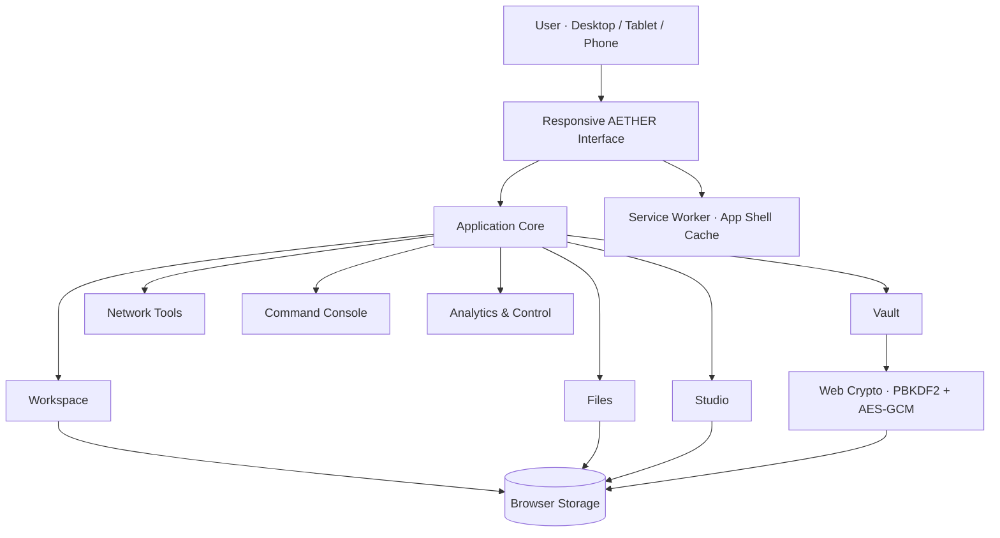

<p align="center">
  
</p>

<p align="center">
  <a href="https://code-forgehq.github.io/"></a>
  <a href="https://github.com/Code-ForgeHQ/Code-ForgeHQ.github.io/actions/workflows/quality.yml"></a>
  <a href="LICENSE"></a>
  <a href="https://github.com/Code-ForgeHQ/Code-ForgeHQ.github.io/commits/main/"></a>
</p>

<p align="center">
  <a href="https://github.com/Code-ForgeHQ"></a>
  
  
  
</p>

<p align="center">
  <strong>One environment. Multiple systems. Your data stays on your device.</strong>
</p>

<p align="center">
  <a href="https://code-forgehq.github.io/">Launch AETHER</a> ·
  <a href="#systems">Explore systems</a> ·
  <a href="docs/ARCHITECTURE.md">Architecture</a> ·
  <a href="docs/USER_GUIDE.md">User guide</a> ·
  <a href="docs/ORGANIZATION.md">Code Forge</a>
</p>

---

## Overview

AETHER is a local-first digital operating environment built as one cohesive browser application. It combines workspace management, local files, a code studio, an encrypted vault, network utilities, an application command console, analytics, and system controls.

It is **not** a collection of unrelated landing-page widgets. Each system lives inside the same navigation model, visual language, localization layer, and local data environment.

| Principle | Implementation |
| --- | --- |
| One responsive product | Shared interface for phones, tablets, and desktop |
| Local-first | Workspace records stay in browser storage |
| No AI dependency | No model downloads, AI APIs, or API keys |
| No build chain | Static HTML, CSS, and JavaScript |
| Privacy-aware | Vault records encrypted with Web Crypto |
| Installable shell | PWA manifest and service-worker cache |
| Bilingual | English-first with Persian localization |

## Live environment

<p align="center">
  <a href="https://code-forgehq.github.io/"></a>
</p>

**Production URL:** https://code-forgehq.github.io/

The application is hosted with GitHub Pages. No account or server-side setup is required to explore the local workspace.

## Systems

<a name="systems"></a>

| System | Capabilities |
| --- | --- |
| **Overview** | Command deck, workspace snapshot, recent activity, quick access |
| **Workspace** | Task creation, priorities, status filters, completion tracking |
| **Files** | Local text-file creation, import, editing, and export |
| **Studio** | Autosaved notes and isolated HTML/CSS/JavaScript preview |
| **Vault** | Browser-side encrypted records using PBKDF2 and AES-GCM |
| **Network** | URL parsing, IPv4 subnet calculations, SHA-256, UUID generation |
| **Terminal** | Built-in AETHER commands; no operating-system shell access |
| **Analytics** | Metrics calculated from local workspace records |
| **Control** | Language, visual effects, data export, and import |
| **Code Forge** | Organization context, project documentation, and public links |

## Architecture



For implementation boundaries and data flows, see [Architecture](docs/ARCHITECTURE.md).

## Performance & compatibility

The interface uses a bounded canvas particle field, reduced-motion support, responsive layouts, and a lightweight static asset pipeline. The visual effects adapt to device capability rather than requiring a graphics-heavy framework.

- Modern Chromium, Firefox, and Safari-based browsers
- Desktop, tablet, and mobile layouts
- HTTPS recommended for service workers and Web Crypto
- Installable where the browser supports PWA installation

## Quick start

No package manager, compilation, API key, or model installation is required.

```bash
git clone https://github.com/Code-ForgeHQ/Code-ForgeHQ.github.io.git
cd Code-ForgeHQ.github.io
```

Open `index.html` in a browser for a basic preview. For full PWA and cryptography support, serve the directory from `localhost` or HTTPS.

## Data & privacy

AETHER does not currently synchronize data between devices. Tasks, notes, preferences, and file records are stored in the current browser profile. Vault entries are encrypted before persistence. Clearing browser data can remove local records.

> [!IMPORTANT]
> Export important workspace data regularly. Vault passphrases are not recoverable by AETHER. The Vault is a privacy-aware local feature, not a substitute for a professionally managed password manager.

See the [Privacy Model](docs/PRIVACY.md) and [Security Policy](SECURITY.md).

## Documentation

| Document | Description |
| --- | --- |
| [Architecture](docs/ARCHITECTURE.md) | Runtime layers, modules, persistence, and boundaries |
| [User Guide](docs/USER_GUIDE.md) | How to use each system |
| [Code Forge](docs/ORGANIZATION.md) | Organization overview and official public links |
| [Roadmap](docs/ROADMAP.md) | Delivered foundation and planned milestones |
| [Privacy Model](docs/PRIVACY.md) | Local data, encryption, and privacy boundaries |
| [Security Policy](SECURITY.md) | Responsible vulnerability reporting |
| [Contributing](CONTRIBUTING.md) | Engineering and pull-request guidelines |
| [Changelog](CHANGELOG.md) | Release history |

## Contributing

Contributions are welcome. Read [CONTRIBUTING.md](CONTRIBUTING.md) first, then open an issue or pull request with a focused description and reproducible details.

## License

AETHER is released under the [MIT License](LICENSE).

---

<p align="center">
  <sub>Designed and developed by <a href="https://github.com/Code-ForgeHQ">Code Forge</a> · AETHER 1.0.0</sub>
</p>

<details>
  <summary>فارسی · درباره AETHER</summary>

  AETHER یک محیط نرم‌افزاری یکپارچه و محلی‌محور است. این پروژه مدیریت وظایف، فایل‌های محلی، استودیو کدنویسی، گاوصندوق رمزگذاری‌شده، ابزارهای شبکه، کنسول داخلی و تحلیل داده را در یک رابط واکنش‌گرا جمع می‌کند.

  نسخه فعلی به هوش مصنوعی، API خارجی، نصب مدل یا فرایند build نیاز ندارد. داده‌ها روی مرورگر همان دستگاه ذخیره می‌شوند و همگام‌سازی ابری در این نسخه ارائه نشده است.

  [ورود به AETHER](https://code-forgehq.github.io/) · [مستندات فارسی و انگلیسی](docs/USER_GUIDE.md)
</details>
