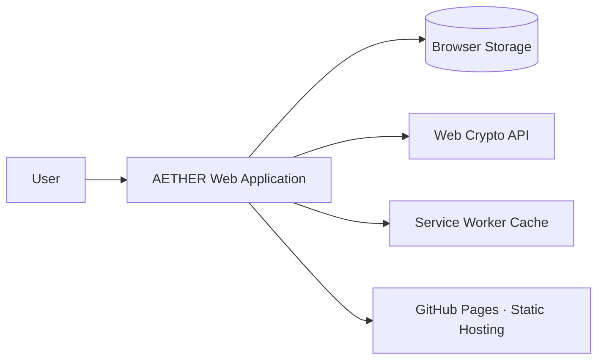
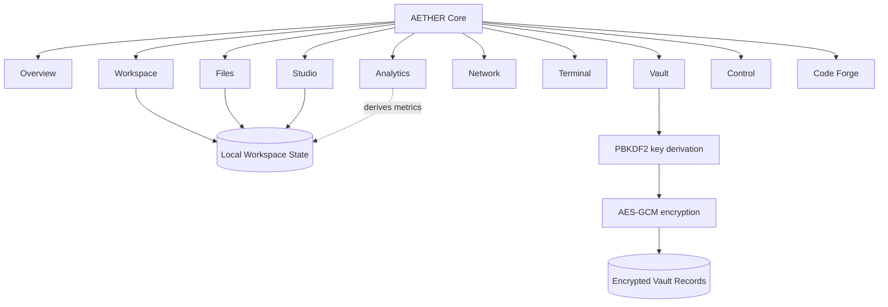

# AETHER Architecture

  <a href="../README.md">← Project home</a>

> [!NOTE]
> AETHER is intentionally deployable as a static site. The browser is the runtime; GitHub Pages serves the application assets.

## 1. System context

## 2. Runtime layers

| Layer | Responsibility | Main implementation |
| --- | --- | --- |
| Presentation | Responsive shell, navigation, views, dialogs | HTML + CSS |
| Application core | Routing, localization, commands, events, state | Vanilla JavaScript |
| Persistence | Workspace records and preferences | localStorage |
| Cryptography | Vault key derivation and authenticated encryption | Web Crypto API |
| Offline shell | Static application asset cache | Service Worker |
| Delivery | Static asset hosting and version history | GitHub Pages + Git |

## 3. Module map

## 4. State and persistence

The application loads a versioned workspace object from localStorage and merges it with defaults. Changes are persisted locally. There is no account service or remote database in the current release.

| Data | Storage | Portability |
| --- | --- | --- |
| Tasks and activity | localStorage | Included in workspace JSON export |
| Local text files | localStorage | Included in workspace JSON export |
| Notes and Studio source | localStorage | Included in workspace JSON export |
| Preferences | localStorage | Included in workspace JSON export |
| Vault records | Encrypted localStorage values | Not included in workspace export |

## 5. Rendering and performance

- The particle field uses a bounded particle count, a capped drawing resolution, and a spatial grid for nearby-line calculations.
- Animation is paused when the document is hidden or the effect is disabled.
- Rendering is frame-limited to reduce unnecessary work.
- Reduced-motion preferences disable continuous particle animation.
- The application avoids a framework runtime and third-party JavaScript bundles.

## 6. Security boundaries

- Vault encryption uses PBKDF2-derived keys and AES-GCM.
- The passphrase and derived key are not persisted.
- Studio preview content runs in a sandboxed iframe.
- Terminal commands are application-level commands, not operating-system execution.
- Network utilities perform local calculations and parsing; they do not probe remote hosts.

## 7. Known limitations

- No cross-device synchronization.
- No server-side account or permission model.
- Browser storage can be cleared or evicted.
- Studio preview is for code the user chooses to test, not a security-analysis sandbox.
- Vault security depends on device integrity and passphrase strength.

## 8. Extension principles

Future modules should preserve static deployment, clear ownership boundaries, accessible interactions, local-first defaults, and explicit disclosure whenever a capability requires a remote service or additional permission.
