# Code Forge

  

  
  

## Organization

**Code Forge** is the GitHub organization under which AETHER is published and maintained.

| Destination | Official resource |
| --- | --- |
| Organization profile | [github.com/Code-ForgeHQ](https://github.com/Code-ForgeHQ) |
| Public repositories | [Repository directory](https://github.com/orgs/Code-ForgeHQ/repositories) |
| Public members | [Organization people](https://github.com/orgs/Code-ForgeHQ/people) |
| AETHER source | [This repository](https://github.com/Code-ForgeHQ/Code-ForgeHQ.github.io) |
| Live application | [code-forgehq.github.io](https://code-forgehq.github.io/) |

## AETHER project charter

AETHER is developed as an open-source software project within Code Forge. Its engineering direction is documented through the following principles:

1. **Useful systems:** each module should provide a practical capability rather than a decorative placeholder.
2. **Clear boundaries:** modules should have explicit responsibilities and data ownership.
3. **Cross-device experience:** the same product should remain usable on phones, tablets, and desktops.
4. **Local-first privacy:** data should remain in the browser unless an explicitly documented feature requires otherwise.
5. **Accessible interaction:** keyboard, touch, contrast, and reduced-motion behavior matter.
6. **Transparent engineering:** limitations and security boundaries must be documented honestly.

## Public information

Current repositories, maintainers, public members, and contributors can change. The official GitHub organization pages linked above are the source of truth.

> [!IMPORTANT]
> This document does not invent internal team size, private membership, unpublished projects, or organizational claims. It describes the public project context visible through Code Forge's GitHub presence and the engineering charter adopted for AETHER.

## Participation

For project questions, bug reports, and contributions, use the issue and pull-request workflow in the relevant public repository. Read [CONTRIBUTING.md](../CONTRIBUTING.md) before submitting a change.
